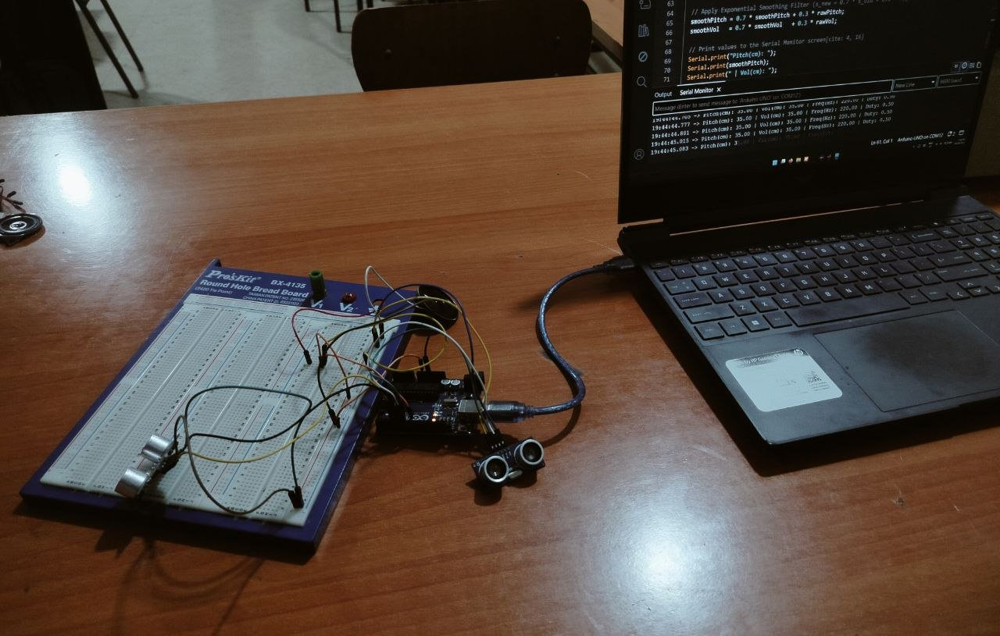
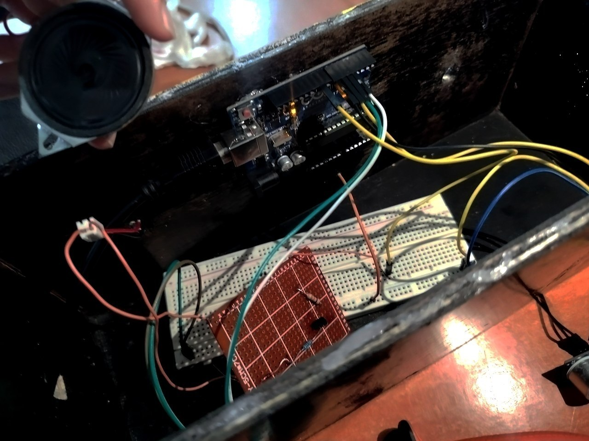

# 🎶 PROJECT RESURRECTION — AIR THEREMIN

### ✨ A touchless musical instrument, powered by curiosity and a little bit of electronics :)

  <strong>IEEE Student Branch · University of Boumerdes (IEEE SBUB)</strong>
   
  <em>Team sʎnth · First-Year Projects Exhibition · 2026</em>

---

## 🎧 What if you could play music without touching an instrument?

Meet **Air Theremin**!

Inspired by the original Theremin, invented by Russian physicist Léon Theremin in 1928, our project brings a classic idea into a modern electronic form.

Using two ultrasonic sensors, an Arduino Uno, and nothing but hand movements, we built an electronic musical instrument that lets you control sound through the air.

No keys. No strings. No physical contact.

Just your hands, some electronics, and music ˖ ݁♬⋆.˚𝄞

---

## ✨ The magic behind it

Air Theremin detects the distance between your hands and two ultrasonic sensors, translating those movements into sound.

| Your movement | What happens |
|---|---|
| ✋ Right hand | Controls the pitch (frequency) |
| ✋ Left hand | Controls the volume (loudness) |

Move your hands closer or farther away, and watch the sound change!

### 📚 How does it work?

1. The two HC-SR04 ultrasonic sensors measure hand distances.
2. The Arduino Uno receives and processes these measurements.
3. The right-hand sensor determines the sound frequency.
4. The left-hand sensor determines the volume.
5. Arduino Timer1 generates a PWM signal to produce the sound.

A little bit of physics, a little bit of programming, and a whole lot of experimentation X3!!

---

## 🛠️ From components to an instrument

Building the Air Theremin was not just about connecting components. Our development process involved several stages:

1. Setting up the Arduino Uno and Arduino IDE.
2. Experimenting with LEDs and digital inputs.
3. Exploring analog readings and PWM using an LDR.
4. Integrating the ultrasonic sensors.
5. Generating sound using Arduino Timer1.
6. Assembling the complete circuit.
7. Testing, troubleshooting, soldering and painting the final prototype.

### 🖼️ Inside the workshop

  
  

  <em>From the first prototype to the final assembly.</em>

---

## 🎞️ See it in action!

The best way to understand an Air Theremin is to see one being played.

**▶️ [WATCH THE AIR THEREMIN DEMONSTRATION](https://drive.google.com/file/d/1ww8G79BqD6kc3VhWqNr-9IXu1tASepQo/view?usp=drive_link)**

---

### 💡 What's next?

There is always room to make things better! Some improvements we'd love to explore:

- 🎨 An LED bar displaying the notes being played.
- 🎹 Different musical scales, including major and pentatonic.
- 🎵 A vibrato effect for more expressive sounds.
- 📡 Improved sensor accuracy and stability.
- 🔊 Better speaker sound quality.

---

## ˙ᵕ˙ The people behind the project

**Team sʎnth** A project built through collaboration, experimentation, and shared curiosity.

### 💙 Special thanks

A project is never built entirely alone.

- **Youcef Harmouni** — Our mentor, for his guidance, the building guide and PCB layout.
- **Amine Khammar** — For the exterior design and painting.

And to everyone who supported us throughout this experience: thank you!

---

  <strong>⚙︎ PROJECT RESURRECTION · IEEE SBUB · 2026 ⏻</strong>
   
  <em>We didn't just build an instrument. We brought an idea back to life.</em>
    
  🎶 Made with curiosity, electronics, and teamwork.

